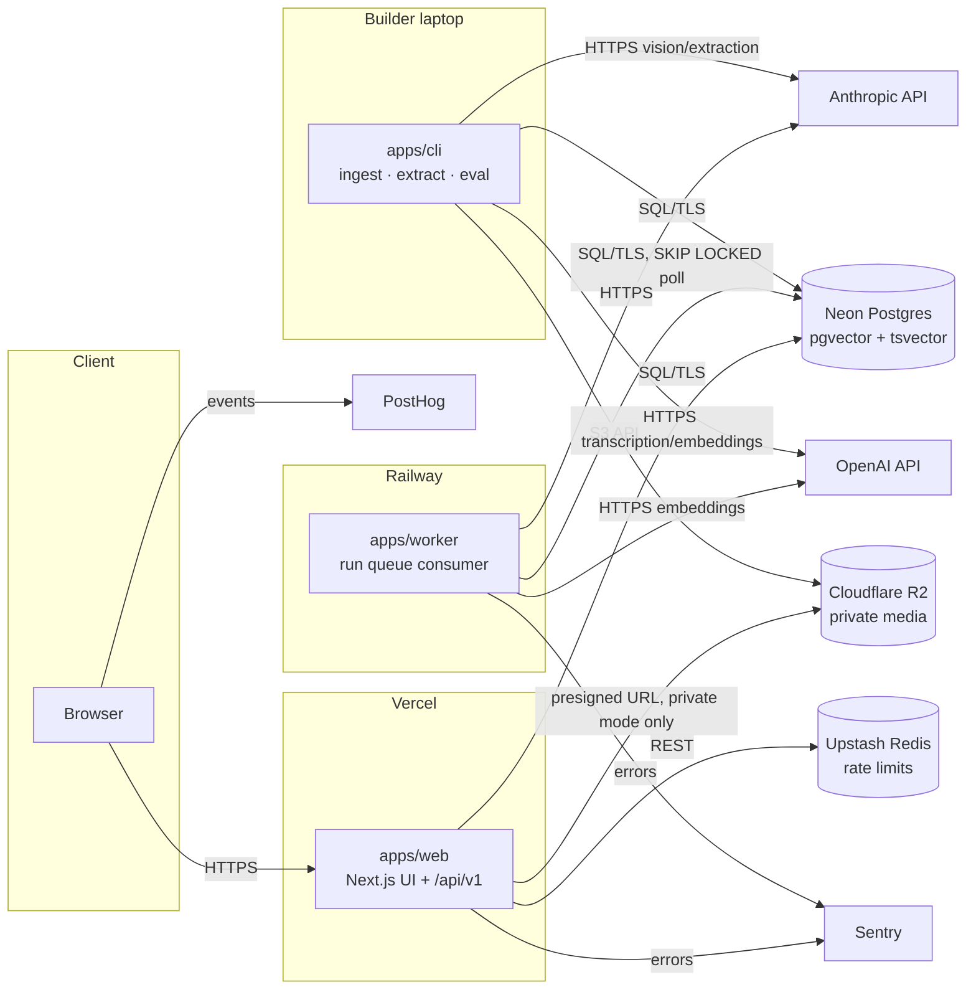
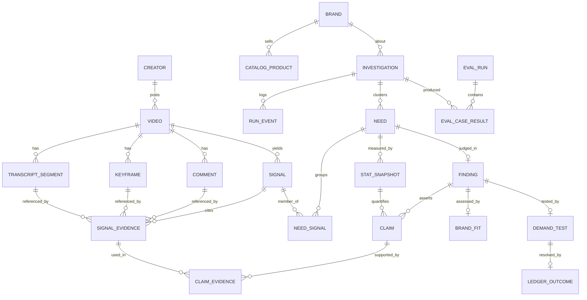
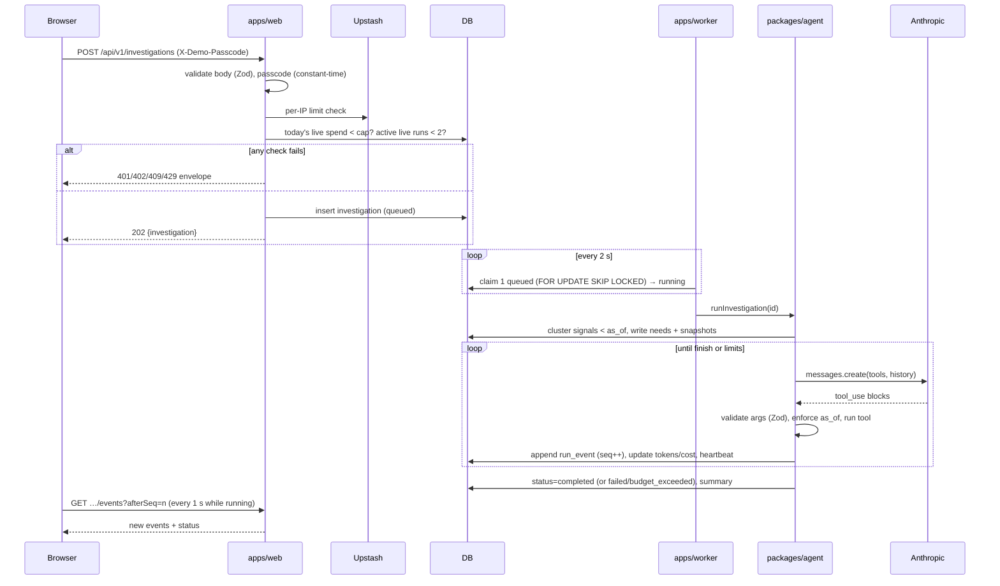
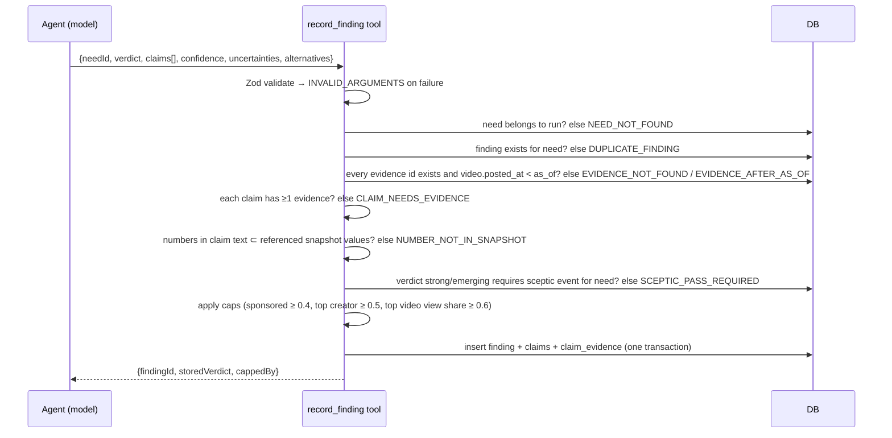
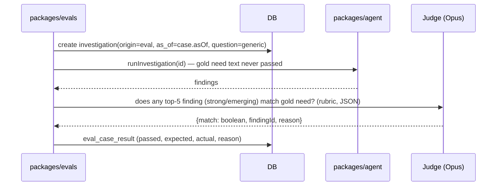
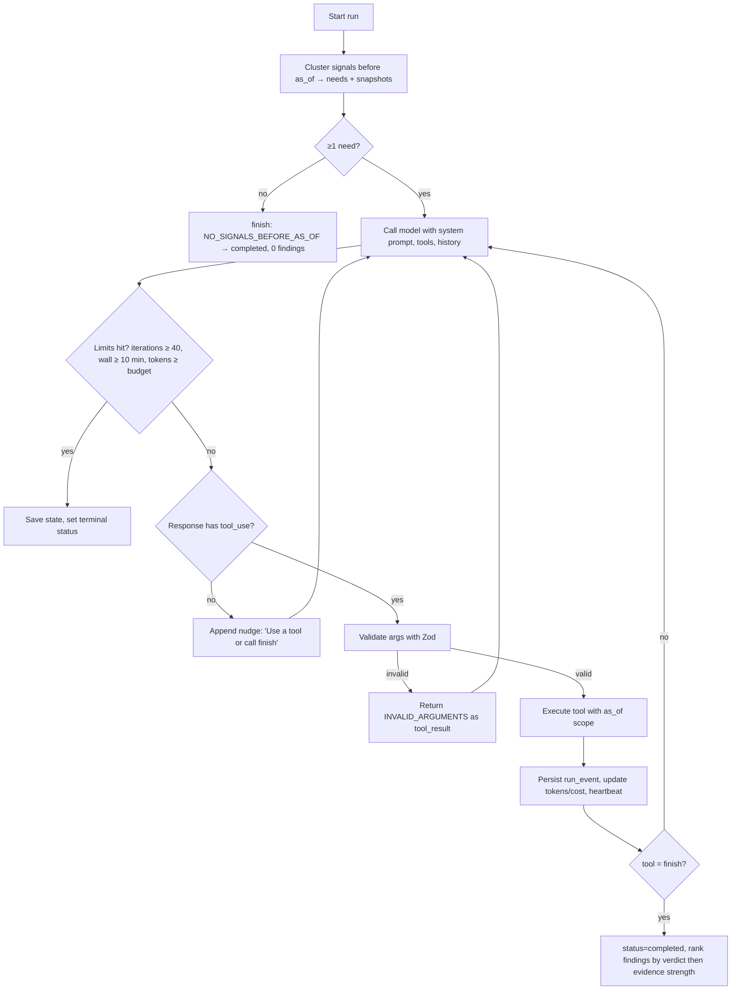

# Unmet — Architecture

> Version: 1.0 · Updated: 2026-10-09 · This document wins any disagreement between code and docs. Change it (with an ADR when non-obvious) before changing a contract.

## 1. System Overview

Unmet has three runtime parts: a **Next.js web app** (UI + read/write API), a **worker** that executes investigations and eval runs from a Postgres-backed queue, and **offline CLI pipelines** (ingest, extract, eval) run by the builder. All share one TypeScript monorepo, one Postgres database (with pgvector and full-text search), and one schema package. Media lives in private object storage and is never served publicly.



## 2. Tech Stack

| Layer | Choice | Version | Rationale |
|---|---|---|---|
| Runtime | Node.js | 24 LTS | Current LTS; native fetch, stable test runner support |
| Language | TypeScript, `strict`, `noUncheckedIndexedAccess` | 5.x | One language across web, worker, CLI, evals |
| Package manager / monorepo | pnpm workspaces + Turborepo | pnpm 10, turbo 2 | Fast installs, cached tasks |
| Web framework | Next.js App Router + React | Next 16, React 19 | Server components for fast published pages; route handlers for API |
| Styling | Tailwind CSS | 4 | Token-driven via CSS variables |
| Components | shadcn/ui on Radix primitives | latest CLI | Accessible, owned source |
| Motion | Motion (`motion/react`) | 12 | Layout animations for need cards and drawer |
| Icons | Lucide React | latest | Consistent stroke icons |
| Client data | TanStack Query | 5 | Polling live run events, cache |
| Charts | Recharts | 2 | Simple time-series and bar charts |
| Toasts / sheets | Sonner, Vaul | latest | Accessible toasts; mobile bottom sheet with drag-to-dismiss |
| Logging / IDs / processes | pino, `uuidv7`, `execa` | latest | Structured logs, time-ordered IDs, ffmpeg invocation |
| Validation / contracts | Zod | 4 | Shared schemas for API, tools and LLM outputs |
| Database | PostgreSQL on Neon with `pgvector` | PG 16 | Relational + vector + full-text in one place; branching for previews |
| ORM / migrations | Drizzle ORM + drizzle-kit | 0.4x | Typed schema, SQL-first |
| LLM (agent, extraction, vision, judge) | Anthropic TypeScript SDK (`@anthropic-ai/sdk`) | latest | Strong tool use; structured tool outputs |
| Transcription + embeddings | OpenAI Node SDK (`openai`) | 5.x | `whisper-1` segment timestamps; `text-embedding-3-small` |
| Media processing | ffmpeg / ffprobe CLI via `execa` | ffmpeg 7 | Audio extraction, keyframes, scene detection |
| Object storage | Cloudflare R2 via `@aws-sdk/client-s3` | v3 | Cheap private storage, S3 API |
| Rate limiting | Upstash Redis + `@upstash/ratelimit` | latest | Serverless-friendly per-IP limits |
| Errors | Sentry (`@sentry/nextjs`, `@sentry/node`) | 9.x | Web + worker errors |
| Product analytics | PostHog (`posthog-js`) | latest | Evidence-open funnel |
| Unit/integration tests | Vitest | 3 | Fast, TS-native |
| E2E / a11y | Playwright + `@axe-core/playwright` | latest | Hero flows + accessibility |
| Network mocks | MSW | 2 | Mock Anthropic/OpenAI in tests |
| Lint/format | Biome | 2 | One fast tool for lint + format |
| Hosting | Vercel (web), Railway (worker, Docker with ffmpeg) | — | Low ops; worker needs long-running process |
| CI | GitHub Actions | — | Typecheck, lint, test, build, E2E on preview |

Versions are majors; P0.T1 verifies current stable versions and model IDs and records them in TASK_LOG.

## 3. Component Boundaries

| Component | Responsibility | Owns | Exposes | Depends on | Must NOT |
|---|---|---|---|---|---|
| `apps/web` | UI, public read API, run creation, admin session | Route handlers in `src/app/api/v1/**` | HTTP API (§5), pages (§7) | `packages/db`, `packages/shared` | Call any LLM or embedding API; run investigations inline; import from `packages/agent` |
| `apps/worker` | Execute queued investigations and eval runs | Queue claiming, heartbeats, run lifecycle | Nothing over the network (health on `:8080/healthz`) | `packages/agent`, `packages/db`, `packages/shared` | Serve user traffic; write to `video`, `signal` tables |
| `apps/cli` | Ingest, extract, embed, brand load, eval commands, local run | Pipeline orchestration, progress output | `pnpm` scripts (INSTRUCTIONS §5) | `packages/pipeline`, `packages/agent`, `packages/evals`, `packages/db` | Be imported by web or worker |
| `packages/pipeline` | Media → transcript, keyframes, descriptions, comments; signal extraction; embeddings | Ingest + extraction logic | Functions: `ingestVideo`, `extractSignals`, `embedSignals` | `packages/llm`, `packages/db`, `packages/storage` | Contain agent logic |
| `packages/agent` | Agent loop, tools, sceptic rules, clustering, stats, fit, demand tests, baseline | Investigation logic | `runInvestigation(id)`, `runBaseline(id)`, tool registry | `packages/llm`, `packages/db`, `packages/stats` | Read data after `as_of`; compute numbers with an LLM |
| `packages/stats` | Deterministic clustering and stat snapshots | Formula versions | `clusterSignals`, `computeSnapshot`, `evidenceStrength` | `packages/db` | Call any external API |
| `packages/llm` | Model clients, prompt loading, token/cost accounting, retries, fallback chain | Pricing table, prompt registry | `callModel`, `callStructured`, `embed`, `transcribe` | Anthropic SDK, OpenAI SDK | Contain business rules |
| `packages/evals` | Suites, scoring, judges, gold data loading | Eval logic | `runSuite(name)` | `packages/agent`, `packages/llm`, `packages/db` | Mutate corpus tables (except `corpus_id` trap fixtures) |
| `packages/db` | Drizzle schema, migrations, repositories, queue helpers | All tables | Typed repositories | Postgres | Contain HTTP or LLM code |
| `packages/storage` | R2 put/get/presign | Bucket layout | `putObject`, `presignGet` | AWS S3 SDK | Presign when `PUBLIC_DEMO_MODE=true` |
| `packages/shared` | Zod schemas, enums, error codes, API types | Contracts | Schemas + inferred types | Zod | Import any runtime package |
| `prompts/` | Versioned prompt files | Prompt text | Loaded by `packages/llm` | — | Be inlined in code |

## 4. Data Model

### 4.1 Conventions

- IDs: `uuid` generated with `uuidv7()` in the app (`uuidv7` package) — time-ordered, sortable.
- Timestamps: `created_at timestamptz not null default now()`, `updated_at` where rows mutate (trigger-free; set in repositories).
- No soft delete. Corpus rows are immutable after ingest except status fields.
- Enums are Postgres enums defined in `packages/db/src/schema/enums.ts` and mirrored as Zod enums in `packages/shared`.
- Tenancy: none (single-operator system). Visibility is per investigation (`private` · `published`).
- Time filter rule: every query used by agent tools joins `video` and filters `video.posted_at < $as_of`. Enforced in `packages/db/src/repos/asof.ts` (§10.4).

### 4.2 ER diagram



### 4.3 Enums

| Enum | Values |
|---|---|
| `platform` | `tiktok`, `youtube_shorts`, `instagram_reels`, `synthetic` |
| `follower_tier` | `nano` (< 10k), `micro` (10k–100k), `mid` (100k–1M), `macro` (> 1M) |
| `ingest_status` | `pending`, `transcribing`, `framing`, `describing`, `complete`, `failed`, `excluded` |
| `extract_status` | `pending`, `extracting`, `complete`, `failed`, `skipped` |
| `signal_type` | `complaint`, `wish`, `workaround`, `dupe_hunt` |
| `stance` | `sincere`, `sarcastic`, `unclear` |
| `sponsored` | `disclosed`, `suspected`, `none` |
| `evidence_source` | `transcript`, `caption`, `frame`, `comment` |
| `run_kind` | `agent`, `baseline` |
| `run_status` | `queued`, `running`, `completed`, `failed`, `cancelled`, `budget_exceeded` |
| `run_origin` | `owner`, `live_demo`, `eval` |
| `visibility` | `private`, `published` |
| `event_type` | `status`, `model_call`, `tool_call`, `tool_result`, `finding_recorded`, `error`, `note` |
| `verdict` | `strong`, `emerging`, `weak`, `rejected` |
| `claim_kind` | `support`, `counter`, `fit`, `uncertainty` |
| `fit_rating` | `strong`, `moderate`, `poor` |
| `test_type` | `content_concept_test`, `creator_seeding`, `waitlist_landing`, `commenter_survey`, `concept_ad_test` |
| `cost_band` | `under_500`, `500_2k`, `2k_10k` |
| `outcome` | `confirmed`, `refuted`, `inconclusive` |
| `eval_suite` | `extraction`, `traps`, `backtest`, `comparison` |
| `system_under_test` | `unmet`, `baseline` |

### 4.4 Tables

**creator**
| Field | Type | Constraints | Notes |
|---|---|---|---|
| id | uuid | PK | |
| platform | platform | not null | |
| handle | text | not null | public creator handle |
| follower_count | integer | not null, ≥ 0 | at collection time |
| follower_tier | follower_tier | not null | derived on insert |
| likely_minor | boolean | not null default false | if true, no videos ingested |
| created_at | timestamptz | not null default now() | |
Unique: (platform, handle).

**video** (F-01)
| Field | Type | Constraints | Notes |
|---|---|---|---|
| id | uuid | PK | |
| corpus_id | text | not null default 'main', indexed | `main` or `trap-<n>` |
| platform | platform | not null | |
| external_id | text | not null | platform video ID |
| source_url | text | not null | original post URL |
| creator_id | uuid | FK → creator.id, not null, indexed | |
| posted_at | timestamptz | not null, indexed | the time filter column |
| duration_ms | integer | nullable | from ffprobe |
| caption | text | not null default '' | |
| hashtags | text[] | not null default '{}' | parsed from caption |
| views | bigint | not null default 0 | at collection |
| likes | bigint | not null default 0 | |
| comments_count | integer | not null default 0 | |
| collected_at | timestamptz | not null | |
| provenance_note | text | not null | how/why collected (query + date bucket) |
| collection_query | text | not null | the fixed search query used (A1 bias control) |
| media_key | text | nullable | R2 key `media/<id>.mp4` |
| is_synthetic | boolean | not null default false | trap fixtures only |
| trap_tags | text[] | not null default '{}' | |
| sponsored_disclosed | boolean | not null default false | deterministic caption check |
| ingest_status | ingest_status | not null default 'pending' | |
| ingest_error | text | nullable | error code |
| extract_status | extract_status | not null default 'pending' | |
| created_at, updated_at | timestamptz | not null | |
Unique: (platform, external_id). Index: (corpus_id, posted_at).

**transcript_segment**
| Field | Type | Constraints | Notes |
|---|---|---|---|
| id | uuid | PK | |
| video_id | uuid | FK → video.id on delete cascade, indexed | |
| start_ms, end_ms | integer | not null, end_ms > start_ms | |
| text | text | not null | |
| tsv | tsvector | generated always as (to_tsvector('english', text)) stored | GIN index |

**keyframe**
| Field | Type | Constraints | Notes |
|---|---|---|---|
| id | uuid | PK | |
| video_id | uuid | FK → video.id cascade, indexed | |
| at_ms | integer | not null | |
| media_key | text | not null | `frames/<video_id>/<at_ms>.jpg` |
| description | text | not null | vision output |
| on_screen_text | text | not null default '' | |
| products_visible | jsonb | not null default '[]' | `[{name, brand?, confidence}]` |

**comment**
| Field | Type | Constraints | Notes |
|---|---|---|---|
| id | uuid | PK | |
| video_id | uuid | FK → video.id cascade, indexed | |
| author_hash | text | not null | sha256(salt + handle); raw handle never stored |
| text | text | not null | |
| like_count | integer | not null default 0 | |
| posted_at | timestamptz | nullable | |

**signal** (F-02)
| Field | Type | Constraints | Notes |
|---|---|---|---|
| id | uuid | PK | |
| video_id | uuid | FK → video.id cascade, indexed | |
| type | signal_type | not null | |
| need_statement | text | not null, length 10–160 | brand-agnostic |
| products | jsonb | not null default '[]' | `[{name, brand?, source: speech\|caption\|visual\|comment}]` |
| stance | stance | not null | |
| sponsored | sponsored | not null | deterministic disclosure overrides |
| confidence | real | not null, 0..1 | |
| embedding | vector(1536) | nullable | HNSW index, cosine |
| tsv | tsvector | generated from need_statement | GIN index |
| extractor_version | text | not null | e.g. `extract@3` |
| repair_attempts | smallint | not null default 0 | |
| created_at | timestamptz | not null | |

**signal_evidence**
| Field | Type | Constraints | Notes |
|---|---|---|---|
| id | uuid | PK | |
| signal_id | uuid | FK → signal.id cascade, indexed | |
| source | evidence_source | not null | |
| transcript_segment_id | uuid | FK nullable | required when source = transcript |
| keyframe_id | uuid | FK nullable | required when source = frame |
| comment_id | uuid | FK nullable | required when source = comment |
| start_ms, end_ms | integer | nullable | |
| excerpt | text | not null, length ≤ 200 | |
Check: exactly one of the three FKs is set unless source = caption (all null).

**brand** — id uuid PK · slug text unique · name text · positioning text · created_at.

**catalog_product**
| Field | Type | Constraints | Notes |
|---|---|---|---|
| id | uuid | PK | |
| brand_id | uuid | FK → brand.id cascade, indexed | |
| name | text | not null | |
| category | text | not null | e.g. `sunscreen`, `serum`, `moisturiser` |
| format | text | not null | e.g. `fluid`, `stick`, `cream` |
| key_ingredients | text[] | not null | lower-cased |
| claims | text[] | not null | |
| skin_types | text[] | not null | |
| url | text | not null | public product page |
| embedding | vector(1536) | nullable | of `name + claims` |

**investigation**
| Field | Type | Constraints | Notes |
|---|---|---|---|
| id | uuid | PK | |
| kind | run_kind | not null | |
| origin | run_origin | not null | |
| brand_id | uuid | FK → brand.id, not null | |
| question | text | not null, length 10–500 | |
| as_of | timestamptz | not null | |
| corpus_id | text | not null default 'main' | |
| status | run_status | not null default 'queued', indexed | |
| visibility | visibility | not null default 'private' | |
| requester_ip_hash | text | nullable | live demo only |
| claimed_by | text | nullable | worker instance id |
| heartbeat_at | timestamptz | nullable | |
| started_at, finished_at | timestamptz | nullable | |
| model_ids | jsonb | not null default '{}' | `{agent, extract, judge}` |
| prompt_versions | jsonb | not null default '{}' | `{ "agent.system": "4", … }` |
| formula_version | text | not null | `es@1` |
| input_tokens, output_tokens | integer | not null default 0 | |
| cost_usd | numeric(10,4) | not null default 0 | |
| iterations | smallint | not null default 0 | |
| error_code | text | nullable | |
| summary | text | nullable | final agent summary |
| created_at, updated_at | timestamptz | not null | |
Index: (status, created_at) for queue claim; (visibility, finished_at desc) for home list.

**run_event**
| Field | Type | Constraints | Notes |
|---|---|---|---|
| id | uuid | PK | |
| investigation_id | uuid | FK cascade | |
| seq | integer | not null | 1..n |
| type | event_type | not null | |
| tool_name | text | nullable | |
| title | text | not null | one-line human summary for timeline |
| payload | jsonb | not null | full input/output (truncated 64 KB) |
| input_tokens, output_tokens | integer | not null default 0 | |
| cost_usd | numeric(10,4) | not null default 0 | |
| latency_ms | integer | not null default 0 | |
| created_at | timestamptz | not null | |
Unique: (investigation_id, seq).

**need** — id uuid PK · investigation_id FK cascade · label text (≤ 80) · description text · centroid vector(1536) · signal_count int · created_at.
**need_signal** — need_id FK cascade · signal_id FK · PK (need_id, signal_id).

**stat_snapshot**
| Field | Type | Constraints | Notes |
|---|---|---|---|
| id | uuid | PK | |
| need_id | uuid | FK cascade, indexed | |
| as_of | timestamptz | not null | |
| window_days | smallint | not null default 90 | |
| formula_version | text | not null | |
| stats | jsonb | not null | `StatSnapshotStats` schema (§10.6) |
| created_at | timestamptz | not null | immutable |

**finding**
| Field | Type | Constraints | Notes |
|---|---|---|---|
| id | uuid | PK | |
| investigation_id | uuid | FK cascade, indexed | |
| need_id | uuid | FK, unique | one finding per need |
| verdict | verdict | not null | after server caps |
| agent_verdict | verdict | not null | what the agent asked for |
| capped_by | text[] | not null default '{}' | `SPONSORED_SHARE`, `CONCENTRATED`, `VIRAL_SKEW` |
| override_reason | text | nullable | |
| confidence | real | not null, 0..1 | |
| summary | text | not null, ≤ 600 chars | |
| uncertainties | text[] | not null | ≥1 when verdict ≠ rejected |
| alternative_explanations | text[] | not null | ≥1 when verdict ≠ rejected |
| sceptic_checked | boolean | not null | |
| rank | smallint | not null | 1..n within run |

**claim** — id uuid PK · finding_id FK cascade · kind claim_kind · text text (≤ 300) · stat_snapshot_id uuid FK nullable (required if text contains a digit) · ordinal smallint.
**claim_evidence** — claim_id FK cascade · signal_evidence_id FK · PK (claim_id, signal_evidence_id).

**brand_fit** — id uuid PK · finding_id FK unique · scores jsonb `{categoryAdjacency, ingredientExpertise, positioning, coverageGap}` each `{score 1–5, reason}` · existing_coverage uuid[] (catalog_product ids) · rating fit_rating · created_at.

**demand_test**
| Field | Type | Constraints | Notes |
|---|---|---|---|
| id | uuid | PK | |
| finding_id | uuid | FK unique | |
| test_type | test_type | not null | |
| hypothesis | text | not null ≤ 300 | |
| audience | text | not null ≤ 200 | |
| activation | text | not null ≤ 500 | |
| primary_metric | text | not null | |
| success_threshold | text | not null | must contain a number |
| stop_condition | text | not null | |
| duration_days | smallint | 3–60 | |
| cost_band | cost_band | not null | |
| predicted_probability | real | 0.05–0.95 | |
| created_at | timestamptz | not null | |

**ledger_outcome** (P1) — id · demand_test_id FK unique · outcome outcome · observed_value text · notes text · recorded_at timestamptz.

**eval_run** — id uuid PK · suite eval_suite · git_sha text · model_ids jsonb · prompt_versions jsonb · formula_version text · started_at · finished_at · metrics jsonb · thresholds jsonb · passed boolean · notes text.
**eval_case_result** — id · eval_run_id FK cascade · case_id text · system system_under_test · investigation_id FK nullable · passed boolean · expected jsonb · actual jsonb · scores jsonb · failure_reason text nullable.

### 4.5 Indexes (query → index)

| Query | Index |
|---|---|
| Queue claim | `investigation(status, created_at)` |
| Home list | `investigation(visibility, finished_at desc)` |
| As-of filtered signal search | `video(corpus_id, posted_at)` + `signal(video_id)` |
| Semantic signal search | HNSW `signal.embedding vector_cosine_ops` (m=16, ef_construction=64) |
| Keyword signal search | GIN `signal.tsv`, GIN `transcript_segment.tsv` |
| Timeline polling | unique `run_event(investigation_id, seq)` |

### 4.6 Migrations & seed

- drizzle-kit generates SQL into `packages/db/migrations/NNNN_<name>.sql`. Never edit an applied migration; add a new one.
- Migration 0000 runs `create extension if not exists vector;`.
- `pnpm db:seed` loads brands from `data/brands/*.json`, the 20-video fixture corpus (`fixtures/corpus-small/`), and one completed fixture investigation for UI work without API keys.
- `pnpm db:seed:traps` loads synthetic trap corpora (`evals/traps/*.json`) under `corpus_id = trap-<n>`.

## 5. API Specification

### 5.1 Conventions

- Base path `/api/v1`. JSON only. Dates ISO 8601 UTC.
- Auth: public reads need nothing; live run creation needs header `X-Demo-Passcode`; admin routes need the `unmet_admin` cookie (HMAC-signed, httpOnly, Secure, SameSite=Strict, 12 h).
- Pagination: `?cursor=<opaque>&limit=` (default 20, max 50) → `{ items, nextCursor }`.
- Rate limits: global 120 req/min per IP on all routes; run creation per §F-13.
- Idempotency: `POST /investigations` accepts `Idempotency-Key` (UUID); same key within 24 h returns the original 202 response.
- Errors use one envelope: `{ "error": { "code": "BUDGET_EXHAUSTED", "message": "Live runs are paused for today.", "details": {} } }`.
- Private resources requested without admin cookie return 404.

### 5.2 Endpoints

| Method | Path | Auth | Request | Response | Codes | Feature |
|---|---|---|---|---|---|---|
| GET | /api/v1/health | public | — | `200 {ok: true, db: boolean}` | 200, 503 | F-13 |
| GET | /api/v1/brands | public | — | `200 {items: BrandSummary[]}` | 200 | F-06 |
| GET | /api/v1/investigations | public (published) / admin (all) | `?cursor&limit&visibility` | `200 {items: InvestigationSummary[], nextCursor}` | 200, 400 VALIDATION | F-08, F-13 |
| POST | /api/v1/investigations | passcode or admin | `CreateInvestigationInput` | `202 {investigation: InvestigationSummary}` | 400 VALIDATION, 401 PASSCODE_INVALID, 402 BUDGET_EXHAUSTED, 404 BRAND_NOT_FOUND, 409 CONCURRENCY_LIMIT, 429 RATE_LIMITED | F-04, F-13 |
| GET | /api/v1/investigations/:id | public if published / admin | — | `200 InvestigationDetail` | 404 NOT_FOUND | F-08 |
| GET | /api/v1/investigations/:id/events | as above | `?afterSeq=0&detail=summary\|full` | `200 {items: RunEvent[], status, lastSeq}` | 404 | F-08, F-10 |
| GET | /api/v1/investigations/:id/findings | as above | — | `200 {items: FindingDetail[]}` | 404 | F-05, F-06, F-07, F-08 |
| POST | /api/v1/investigations/:id/cancel | admin | — | `200 InvestigationSummary` | 404, 409 NOT_CANCELLABLE | F-04 |
| PATCH | /api/v1/investigations/:id | admin | `{visibility}` | `200 InvestigationSummary` | 400, 404, 409 NOT_COMPLETED | F-13 |
| GET | /api/v1/evidence/:id | public if any published finding cites it / admin | — | `200 EvidenceDetail` | 404 | F-08, F-13 |
| GET | /api/v1/stat-snapshots/:id | as evidence | — | `200 StatSnapshot` | 404 | F-03, F-08 |
| GET | /api/v1/eval-runs | public | `?suite` | `200 {items: EvalRunSummary[]}` | 200 | F-09 |
| GET | /api/v1/eval-runs/:id | public | — | `200 EvalRunDetail` | 404 | F-09 |
| GET | /api/v1/corpus/stats | public | — | `200 CorpusStats` | 200, 503 STATS_UNAVAILABLE | F-14 |
| POST | /api/v1/admin/session | public | `{token}` | `204` + cookie | 401 ADMIN_TOKEN_INVALID, 429 | F-13 |
| DELETE | /api/v1/admin/session | admin | — | `204` | — | F-13 |
| GET | /api/v1/ledger | public | — | `200 {items: LedgerEntry[], calibration: CalibrationBin[] \| null}` | 200 | F-11 |
| POST | /api/v1/demand-tests/:id/outcome | admin | `{outcome, observedValue, notes}` | `201 LedgerEntry` | 400, 404, 409 OUTCOME_EXISTS | F-11 |
| GET | /api/v1/findings/:id/handoff | as findings | — | `200 HandoffBrief` (Content-Disposition attachment) | 404, 409 NOT_ELIGIBLE | F-12 |

### 5.3 Key schemas (`packages/shared/src/schemas`)

```ts
export const CreateInvestigationInput = z.object({
  brandId: z.uuid(),
  question: z.string().min(10).max(500),
  asOf: z.iso.datetime().optional(),           // default: latest video posted_at + 1 day
  mode: z.enum(["agent", "baseline"]).default("agent"),
});

export const InvestigationSummary = z.object({
  id: z.uuid(), kind: RunKind, status: RunStatus, visibility: Visibility,
  brand: z.object({ id: z.uuid(), displayName: z.string() }), // "A skincare brand like …"
  question: z.string(), asOf: z.iso.datetime(),
  startedAt: z.iso.datetime().nullable(), finishedAt: z.iso.datetime().nullable(),
  costUsd: z.number(), findingsCount: z.number().int(), errorCode: z.string().nullable(),
});

export const EvidenceDetail = z.object({
  id: z.uuid(), source: EvidenceSource, excerpt: z.string().max(200),
  startMs: z.number().int().nullable(), endMs: z.number().int().nullable(),
  frameDescription: z.string().nullable(),
  imageUrl: z.url().nullable(),               // always null when PUBLIC_DEMO_MODE=true
  video: z.object({
    id: z.uuid(), platform: Platform, sourceUrl: z.url(), openUrl: z.url(), // openUrl adds ?t= for YouTube
    postedAt: z.iso.datetime(), views: z.number().int(), isSynthetic: z.boolean(),
  }),
  creator: z.object({ handle: z.string(), followerTier: FollowerTier }),
  signal: z.object({ id: z.uuid(), type: SignalType, stance: Stance, sponsored: Sponsored, needStatement: z.string() }),
});
```

Example `GET /api/v1/investigations/:id/findings` item (abridged):

```json
{
  "id": "0192c3a1-…",
  "rank": 1,
  "need": { "id": "0192c3a0-…", "label": "Sunscreen that doesn't dry out skin", "signalCount": 23 },
  "verdict": "emerging", "agentVerdict": "strong", "cappedBy": ["CONCENTRATED"],
  "confidence": 0.62,
  "summary": "Mostly micro creators describing mixing moisturiser into sunscreen…",
  "uncertainties": ["Recent window has only 14 signals"],
  "alternativeExplanations": ["A single brand's reformulation complaints may drive half the volume"],
  "claims": [
    { "id": "…", "kind": "support", "text": "Signals rose from 6 to 17 between windows", "statSnapshotId": "…", "evidenceIds": ["…", "…"] },
    { "id": "…", "kind": "counter", "text": "Three creators say an existing tinted fluid already solves this", "statSnapshotId": null, "evidenceIds": ["…"] }
  ],
  "brandFit": { "rating": "strong", "scores": { "coverageGap": { "score": 4, "reason": "…" } }, "existingCoverage": [] },
  "demandTest": { "testType": "content_concept_test", "successThreshold": "≥ 2% of viewers comment asking where to buy", "predictedProbability": 0.45 }
}
```

### 5.4 Error code catalogue

| Code | HTTP | Meaning | User message |
|---|---|---|---|
| VALIDATION | 400 | Body/query failed schema | "Check the highlighted fields." |
| PASSCODE_INVALID | 401 | Missing or wrong demo passcode | "That passcode didn't work." |
| ADMIN_TOKEN_INVALID | 401 | Wrong admin token | "Invalid token." |
| FORBIDDEN | 403 | Admin mutation with a foreign `Origin` | "This action isn't allowed from here." |
| BUDGET_EXHAUSTED | 402 | Daily live-run spend cap reached | "Live runs are paused for today — explore the published investigations." |
| NOT_FOUND / BRAND_NOT_FOUND | 404 | Missing or private | "We couldn't find that." |
| CONCURRENCY_LIMIT | 409 | 2 live runs already active | "Two investigations are running. Try again in a few minutes." |
| NOT_CANCELLABLE / NOT_COMPLETED / OUTCOME_EXISTS / NOT_ELIGIBLE | 409 | State conflict | Specific message per code |
| RATE_LIMITED | 429 | Per-IP limit | "You've hit today's limit of live runs." + `details.retryAfterSeconds` |
| STATS_UNAVAILABLE | 503 | DB unreachable for stats | "Stats unavailable" |
| INTERNAL | 500 | Unexpected | "Something broke on our side. It's been logged." |

Run-level `error_code` values (stored on `investigation`, shown in the failed banner): `MODEL_UNAVAILABLE`, `TOOL_LOOP_LIMIT`, `TIMEOUT`, `WORKER_LOST`, `NO_SIGNALS_BEFORE_AS_OF`, `INTERNAL`.

Tool-level error codes (returned to the agent as tool results, never HTTP): `CLAIM_NEEDS_EVIDENCE`, `NUMBER_NOT_IN_SNAPSHOT`, `EVIDENCE_AFTER_AS_OF`, `EVIDENCE_NOT_FOUND`, `SCEPTIC_PASS_REQUIRED`, `NEED_NOT_ELIGIBLE`, `NEED_NOT_FOUND`, `DUPLICATE_FINDING`, `INVALID_ARGUMENTS`.

## 6. Data Flows

### 6.1 Ingest and extract (CLI, offline) — F-01, F-02

```mermaid
sequenceDiagram
  participant CLI as apps/cli
  participant P as packages/pipeline
  participant FF as ffmpeg
  participant OA as OpenAI
  participant AN as Anthropic
  participant R2
  participant DB
  CLI->>DB: upsert creators + videos from manifest (status pending/excluded)
  loop each pending video (concurrency 4)
    P->>FF: extract audio (16 kHz mono)
    P->>OA: whisper-1 verbose_json, segment timestamps
    OA-->>P: segments
    P->>DB: insert transcript_segment; status=framing
    P->>FF: keyframes (0.5 s + scene > 0.35, cap 8, min 4)
    P->>R2: put media + frames
    P->>AN: describe frames (Haiku, image batch of ≤ 8)
    alt invalid output after 2 repairs
      P->>DB: status=failed, ingest_error=DESCRIBE_INVALID
    else ok
      P->>DB: insert keyframe rows; status=complete
    end
  end
  CLI->>P: extractSignals(video) for complete videos
  P->>AN: structured extraction (Haiku) over transcript+caption+frames+comments
  P->>P: validate evidence refs belong to video; apply sponsored rule; workaround rule
  P->>DB: insert signal + signal_evidence; extract_status=complete
  CLI->>OA: embed need_statements (batch 100)
  CLI->>DB: update signal.embedding
```

### 6.2 Live investigation



### 6.3 Recording a finding (validation path)



### 6.4 Backtest case



## 7. Frontend Architecture

### 7.1 Route map

| Path | Page | Access | Data loaded (endpoint) | Features |
|---|---|---|---|---|
| `/` | Home: hero, published investigations, eval headline | public | RSC: `investigations?visibility=published`, `eval-runs` | F-08, F-09, F-13 |
| `/investigations/new` | Start a live run | public (passcode in form) | `brands` | F-04, F-13 |
| `/investigations/[id]` | Workspace (`?need=&evidence=&tab=`) | public if published | RSC: investigation, findings; client: events polling, evidence, stat snapshot | F-03–F-08 |
| `/evals` | Eval dashboard | public | `eval-runs` | F-09 |
| `/evals/[id]` | Eval run detail with failures | public | `eval-runs/:id` | F-09 |
| `/traces/[id]` | Run trace | public if published | `investigations/:id`, `events?detail=full` | F-10 |
| `/about` | Methodology & limitations | public | `corpus/stats` | F-14 |
| `/ledger` | Prediction ledger (P1) | public | `ledger` | F-11 |
| `/admin` | Admin login + run list | cookie | `admin/session`, `investigations` | F-13 |

### 7.2 Layout & state

- Root layout: top bar (wordmark, nav: Investigations · Evals · About), content area, toasts (Sonner).
- Server state: published pages render as React Server Components reading through `packages/db` repositories in `apps/web/src/server/` (no client fetch for first paint). Live state (events, evidence drawer, snapshots) via TanStack Query hooks in `apps/web/src/lib/api/`, which call only endpoints in §5.2.
- URL state: `need`, `evidence`, `tab` in the workspace (`nuqs`-free; use `useSearchParams` + `router.replace`).
- Client state: only UI state (drawer open, timeline collapsed).
- Polling: `useInvestigationEvents(id)` polls `/events?afterSeq=` every 1000 ms while status ∈ {queued, running}; stops on terminal status; refetches findings once on completion.
- Forms: React Hook Form + Zod resolver using `CreateInvestigationInput`.
- Optimistic updates: none (all writes are admin or run creation; show pending states instead).
- Error boundaries: per route `error.tsx` rendering the error envelope message + retry.

## 8. Third-Party Integrations

| Integration | Purpose | Package | Auth | Env vars | Webhooks | Limits | Failure behaviour | Local dev |
|---|---|---|---|---|---|---|---|---|
| Anthropic | Agent, extraction, vision, judge | `@anthropic-ai/sdk` | API key | `ANTHROPIC_API_KEY`, `MODEL_AGENT`, `MODEL_EXTRACT`, `MODEL_VISION`, `MODEL_JUDGE`, `MODEL_FALLBACK` | none | Org rate limits | Retry 429/5xx/overloaded ×3 (exp backoff 1 s, 2 s, 4 s + jitter); then fallback model once; then `MODEL_UNAVAILABLE` | MSW handlers + recorded fixtures (`fixtures/llm/*.json`) |
| OpenAI | Transcription, embeddings | `openai` | API key | `OPENAI_API_KEY`, `TRANSCRIBE_MODEL`, `EMBEDDING_MODEL` | none | Org rate limits; 25 MB audio cap | Retry ×3; ingest marks video failed with `TRANSCRIBE_FAILED` | MSW + fixture transcripts |
| Cloudflare R2 | Private media + frames | `@aws-sdk/client-s3`, `@aws-sdk/s3-request-presigner` | Access key | `R2_ACCOUNT_ID`, `R2_ACCESS_KEY_ID`, `R2_SECRET_ACCESS_KEY`, `R2_BUCKET` | none | — | Ingest retries ×3; web returns `imageUrl: null` on presign failure | Local filesystem driver when `STORAGE_DRIVER=fs` (writes `.data/storage/`) |
| Neon Postgres | Database | `@neondatabase/serverless` (web), `pg` (worker/cli) | Connection string | `DATABASE_URL`, `DATABASE_URL_UNPOOLED` | none | Plan limits | Web: 503 on health; worker retries connect with backoff | Docker `pgvector/pgvector:pg16` via `docker compose up db` |
| Upstash Redis | Rate limiting | `@upstash/ratelimit`, `@upstash/redis` | REST token | `UPSTASH_REDIS_REST_URL`, `UPSTASH_REDIS_REST_TOKEN` | none | — | Fail closed for run creation (429), fail open for reads | In-memory limiter when `RATE_LIMIT_DRIVER=memory` |
| Sentry | Errors | `@sentry/nextjs`, `@sentry/node` | DSN | `SENTRY_DSN` | none | — | No-op if unset | Unset locally |
| PostHog | Product analytics | `posthog-js` | Project key | `NEXT_PUBLIC_POSTHOG_KEY`, `NEXT_PUBLIC_POSTHOG_HOST` | none | — | No-op if unset | Unset locally |

PostHog events: `investigation_viewed {id, published}`, `need_opened {needId, rank}`, `evidence_opened {evidenceId, source}`, `tab_switched {tab}`, `live_run_started {id}`, `live_run_completed {id, status, durationMs}`, `eval_case_opened {caseId}`, `trace_opened {id}`.

## 9. Background Jobs & Scheduling

| Job | Trigger | Payload | Idempotency | Retries / backoff | Timeout | Dead letter |
|---|---|---|---|---|---|---|
| `investigation.run` | Worker poll claims `status=queued` | investigation id | Claim via `UPDATE … SET status='running', claimed_by=$w WHERE id=(SELECT id … FOR UPDATE SKIP LOCKED LIMIT 1)` | None at run level (model calls retry internally) | 10 min wall clock → `failed/TIMEOUT` | Row stays `failed` with `error_code` |
| `investigation.reap` | Worker start + every 60 s | — | Marks `running` rows with `heartbeat_at < now() - 2 min` as `failed/WORKER_LOST` | — | — | — |
| `eval.suite` | `pnpm eval:*` (CLI, local) | suite name | New `eval_run` row per invocation | Case-level retry ×1 on `MODEL_UNAVAILABLE` | 15 min per case | Case recorded `passed=false`, `failure_reason=ERROR:<code>` |
| `ingest.video` | `pnpm ingest` | video id | Stage-skipping by `ingest_status` | ×3 per external call | 5 min per video | `failed` + `ingest_error` |
| `privacy.ip_hash_expiry` | Worker, daily at 03:00 UTC | — | `UPDATE investigation SET requester_ip_hash = NULL WHERE created_at < now() - interval '30 days'` | next day | 1 min | logged warning |
| `queue.unclaimed_expiry` | Worker, every 60 s | — | Marks `queued` rows older than 15 min as `failed/WORKER_LOST` | — | — | — |

Worker concurrency: 2 investigations at once. Heartbeat written every 15 s and on every event.

## 10. AI Subsystem

### 10.1 Models per task

| Task | Env var | Default | Why |
|---|---|---|---|
| Investigation agent | `MODEL_AGENT` | `claude-sonnet-5-5` | Strong multi-step tool use at moderate cost |
| Signal extraction, need labels | `MODEL_EXTRACT` | `claude-haiku-5-5` | High volume, structured output |
| Keyframe description | `MODEL_VISION` | `claude-haiku-5-5` | Cheap image understanding |
| Fit scoring | `MODEL_EXTRACT` | `claude-haiku-5-5` | Rubric scoring |
| Eval judge | `MODEL_JUDGE` | `claude-opus-5-5` | Different, stronger model than the agent to reduce self-preference |
| Fallback for agent | `MODEL_FALLBACK` | `claude-opus-5-5` | Used once after retries fail |
| Baseline | `MODEL_AGENT` | same as agent | Fair comparison: same model, no tools |
| Transcription | `TRANSCRIBE_MODEL` | `whisper-1` | Segment timestamps |
| Embeddings | `EMBEDDING_MODEL` | `text-embedding-3-small` (1536 d) | Cheap, good enough for clustering |

### 10.2 Prompts

Versioned files in `prompts/<name>.v<N>.md` with YAML front matter (`name`, `version`, `model_hint`, `changelog`). Loaded by `packages/llm/src/prompts.ts`; the active version map lives in `prompts/registry.json`. Files: `agent.system`, `agent.baseline`, `extract.signals`, `vision.keyframes`, `need.label`, `fit.score`, `judge.backtest_match`, `judge.citation_support`. Prompt version is written to every `investigation.prompt_versions` and `eval_run.prompt_versions`. Long static system prompts use prompt caching (`cache_control: {type: "ephemeral"}` on the system block and tool definitions).

### 10.3 Agent tools (strict JSON Schema generated from Zod)

| Tool | Read/Write | Input | Output | Notes |
|---|---|---|---|---|
| `list_needs` | read | `{sort: "evidence_strength"\|"growth"\|"unique_creators", limit ≤ 20}` | `[{needId, label, signalCount, snapshotId, evidenceStrength, flags}]` | Needs already clustered at run start |
| `get_need_stats` | read | `{needId}` | full `StatSnapshotStats` + `snapshotId` | Deterministic only |
| `search_signals` | read | `{query, types?: SignalType[], needId?, limit ≤ 20}` | `[{signalId, evidenceIds, type, needStatement, stance, sponsored, videoId, postedAt, excerpt}]` | Hybrid: tsvector + vector, RRF k=60, as_of filtered |
| `inspect_video` | read | `{videoId}` | metadata, transcript (≤ 3k tokens), frame descriptions, signals, top 10 comments (hashed authors) | as_of enforced |
| `find_counterevidence` | read | `{needId}` | `{alreadySolved[], contradictingStance[], sarcastic[], sponsoredShare, topCreatorShare, topVideoViewShare, recentTrend}` | Records a `sceptic` marker event for the need |
| `assess_brand_fit` | read (+ LLM) | `{needId}` | `{rating, scores, existingCoverage[]}` and persists `brand_fit` when a finding exists, else caches | Fit LLM sees catalogue + need label + 5 evidence excerpts |
| `record_finding` | write | `{needId, verdict, confidence, summary, claims[{kind, text, evidenceIds[], statSnapshotId?}], uncertainties[], alternativeExplanations[], overrideReason?}` | `{findingId, storedVerdict, cappedBy}` | Validation path §6.3 |
| `propose_demand_test` | write | `DemandTestInput` | `{demandTestId}` | Only for strong/emerging findings |
| `finish` | write | `{summary ≤ 600 chars}` | `{ok}` | Ends loop; requires ≥3 findings unless no needs exist |

Read tools return at most 6k tokens each; longer outputs are truncated with `"truncated": true`.

### 10.4 As-of enforcement

`packages/db/src/repos/asof.ts` exports `asOfScope(runId)` returning `{asOf, corpusId}` loaded from the investigation row; every tool handler must obtain data through repository functions that take this scope and add `video.posted_at < asOf AND video.corpus_id = corpusId`. A lint rule (`no-restricted-imports`) forbids `packages/agent/src/tools/**` from importing Drizzle table objects directly. Test T-F09-AC2 injects a future-dated signal and asserts it never appears.

### 10.5 Agent loop



Context strategy: history keeps every assistant turn but compacts tool results older than 8 turns to a 1-line summary (`title` field) plus IDs; the full payload remains in `run_event`. The system prompt states the method (survey → shortlist 5–8 needs → for each: stats, evidence, sceptic, fit → record → tests → finish) but the model chooses order and depth.

### 10.6 Clustering & Evidence Strength (formula `es@1`)

- Clustering: signals with embeddings, `posted_at < as_of`, stance ≠ `sarcastic`; sort by `posted_at`; assign each to the nearest centroid if cosine ≥ 0.80 else start a new cluster; recompute centroid as mean; drop clusters with < 3 signals; label each with `need.label` prompt (Haiku) from 8 sampled need statements.
- `StatSnapshotStats`:

```ts
{
  windowDays: 90,
  recentCount: number, priorCount: number, totalCount: number,
  growthRatio: number,                 // (recent+1)/(prior+1), 3 dp
  uniqueCreators: number,
  topCreatorShare: number,             // max signals by one creator / total
  topVideoViewShare: number,           // views of most-viewed video / views of all videos in need
  sponsoredShare: number,              // signals with sponsored ≠ none / total
  sarcasticExcluded: number,
  typeMix: Record<SignalType, number>,
  tierMix: Record<FollowerTier, number>,
  monthly: { month: "YYYY-MM", count: number }[], // last 12 months before as_of
  flags: ("CONCENTRATED" | "VIRAL_SKEW" | "SPONSORED_HEAVY" | "DECLINING" | "THIN")[],
  evidenceStrength: number             // 0..100, 1 dp
}
```

- Flags: `CONCENTRATED` topCreatorShare ≥ 0.5; `VIRAL_SKEW` topVideoViewShare ≥ 0.6; `SPONSORED_HEAVY` sponsoredShare ≥ 0.4; `DECLINING` growthRatio < 0.8; `THIN` totalCount < 6.
- Evidence Strength: `100 × clamp01( 0.35·min(1, log10(1+uniqueCreators)/log10(31)) + 0.25·min(1, (growthRatio−0.5)/2.5) + 0.20·(1−topCreatorShare) + 0.10·(1−sponsoredShare) + 0.10·min(1, typeMix.workaround·2/totalCount) )`. Weights are hand-set (Assumption A7) and shown on `/about`.

### 10.7 Baseline

One call to `MODEL_AGENT` with `prompts/agent.baseline` and the concatenated corpus before `as_of` (per video: id, date, creator tier, caption, transcript, frame descriptions), truncated oldest-first to 150k input tokens. It must return JSON `{findings: [{label, verdict, summary, claims: [{text, videoIds[]}]}]}`. Parsed into the same finding tables with `claim_evidence` pointing at the first evidence of any signal in the cited video (or none). Unsupported numbers are counted, not blocked.

### 10.8 Token accounting

Every model call goes through `packages/llm.callModel`, which reads `usage` (including cache read/write tokens), prices it from `packages/llm/src/pricing.ts` (verified in P0.T1), writes tokens/cost to the run event and increments `investigation` totals in the same transaction.

## 11. Security Architecture

- **AuthN:** no user accounts. Admin: `POST /admin/session` compares `token` with `ADMIN_TOKEN` using `crypto.timingSafeEqual`, sets an HMAC-SHA256-signed cookie (`ADMIN_COOKIE_SECRET`) with 12 h expiry. Demo passcode compared the same way.
- **AuthZ matrix:**

| Action | Public | Passcode holder | Admin |
|---|---|---|---|
| Read published investigation, findings, evidence, trace | ✓ | ✓ | ✓ |
| Read private run | ✗ (404) | ✗ (404) | ✓ |
| Start live run | ✗ | ✓ (limits) | ✓ (no IP limit, still budget-capped) |
| Cancel / publish / record outcome | ✗ | ✗ | ✓ |
| Frame images / media | ✗ | ✗ | ✓ only when `PUBLIC_DEMO_MODE=false` |

- Policy checks live in one module: `apps/web/src/server/policy.ts` (`canRead(run, session)`, `requireAdmin`, `requirePasscode`).
- Input validation: Zod at every route handler and tool boundary.
- Secrets: env vars only (Vercel / Railway dashboards); validated at boot with `@t3-oss/env-nextjs` (web) and a Zod env schema (worker, cli).
- Headers: CSP `default-src 'self'; img-src 'self' data: https://*.r2.cloudflarestorage.com; connect-src 'self' https://*.posthog.com https://*.sentry.io; frame-ancestors 'none'`; HSTS; `X-Content-Type-Options: nosniff`; `Referrer-Policy: strict-origin-when-cross-origin`.
- CSRF: admin mutations require SameSite=Strict cookie and `Origin` header matching `APP_URL`.
- Prompt injection: corpus text (transcripts, captions, comments) is untrusted and wrapped in `<untrusted_content>` tags; see EVAL_GUARDRAILS §3.
- IP handling: `requester_ip_hash = sha256(IP_HASH_SALT + ip)`; raw IPs never stored.

## 12. Environments & Configuration

| Environment | Web | Worker | DB | Storage | Notes |
|---|---|---|---|---|---|
| local | `pnpm dev` (3000) | `pnpm dev` (same turbo) | Docker pgvector | `fs` driver | Works with no API keys using fixture data |
| preview | Vercel preview per PR | none | Neon branch per PR | R2 | Read-only demo of seeded fixture data; runs disabled (`LIVE_RUNS_ENABLED=false`) |
| production | Vercel | Railway | Neon main | R2 | `PUBLIC_DEMO_MODE=true` |

| Variable | Required | Example (fake) | Used by | Secret |
|---|---|---|---|---|
| `APP_URL` | yes | `https://unmet.example.com` | web | no |
| `DATABASE_URL` | yes | `postgres://u:p@host/db?sslmode=require` | web, worker, cli | yes |
| `DATABASE_URL_UNPOOLED` | yes (migrations) | `postgres://u:p@host-direct/db` | cli | yes |
| `ANTHROPIC_API_KEY` | worker, cli | `sk-ant-fake-key` | worker, cli | yes |
| `OPENAI_API_KEY` | worker, cli | `sk-fake-key` | worker, cli | yes |
| `MODEL_AGENT` | no | `claude-sonnet-5-5` | worker, cli | no |
| `MODEL_EXTRACT` | no | `claude-haiku-5-5` | cli, worker | no |
| `MODEL_VISION` | no | `claude-haiku-5-5` | cli | no |
| `MODEL_JUDGE` | no | `claude-opus-5-5` | cli | no |
| `MODEL_FALLBACK` | no | `claude-opus-5-5` | worker, cli | no |
| `TRANSCRIBE_MODEL` | no | `whisper-1` | cli | no |
| `EMBEDDING_MODEL` | no | `text-embedding-3-small` | cli, worker | no |
| `STORAGE_DRIVER` | no | `r2` or `fs` | web, cli | no |
| `R2_ACCOUNT_ID` / `R2_ACCESS_KEY_ID` / `R2_SECRET_ACCESS_KEY` / `R2_BUCKET` | when `STORAGE_DRIVER=r2` | `abc123` / `AKIA…` / `…` / `unmet-media` | web, cli | yes (keys) |
| `UPSTASH_REDIS_REST_URL` / `UPSTASH_REDIS_REST_TOKEN` | prod | `https://x.upstash.io` / `AX…` | web | token yes |
| `RATE_LIMIT_DRIVER` | no | `upstash` or `memory` | web | no |
| `DEMO_PASSCODE` | prod | `plot-demo-2026` | web | yes |
| `ADMIN_TOKEN` | yes | 32+ random chars | web | yes |
| `ADMIN_COOKIE_SECRET` | yes | 32+ random chars | web | yes |
| `IP_HASH_SALT` | yes | 32+ random chars | web | yes |
| `COMMENT_HASH_SALT` | cli | 32+ random chars | cli | yes |
| `PUBLIC_DEMO_MODE` | no | `true` | web | no |
| `LIVE_RUNS_ENABLED` | no | `true` | web | no |
| `DAILY_LIVE_RUN_BUDGET_USD` | no | `15` | web | no |
| `RUN_TOKEN_BUDGET` | no | `600000` | worker | no |
| `SENTRY_DSN` | no | `https://…@sentry.io/1` | web, worker | no |
| `NEXT_PUBLIC_POSTHOG_KEY` / `NEXT_PUBLIC_POSTHOG_HOST` | no | `phc_…` / `https://eu.i.posthog.com` | web | no |
| `WORKER_ID` | no | `worker-1` | worker | no |
| `LLM_MODE` | no | `live` (prod) · `replay` (tests) · `record` | worker, cli, tests | no |

## 13. Deployment & Infrastructure

- **Web:** Vercel project rooted at `apps/web`, build `pnpm turbo build --filter=web`. Region `lhr1` (London) with Neon in `aws-eu-west-2`.
- **Worker:** Railway service from `apps/worker/Dockerfile` (Node 24 slim + ffmpeg), one instance, restart policy always, health check `GET :8080/healthz`.
- **CLI:** runs on the builder's machine against production DB for ingest/extract/evals (`.env.production.local`, never committed).
- **Migrations:** `pnpm db:migrate` run by CI on merge to `main` before the Vercel production deploy is promoted; preview branches migrate their Neon branch.
- **CI/CD:** GitHub Actions — install → typecheck → lint → unit/integration (with Docker pgvector service) → build → Playwright against Vercel preview.
- **Rollback:** Vercel "promote previous deployment"; Railway redeploy previous image; migrations are additive-only so code rollback is safe.
- **Backups:** Neon point-in-time restore (7 days); before every eval sweep, `pnpm db:snapshot` creates a Neon branch named `snap-YYYYMMDD`.
- **Domain:** a custom subdomain on the builder's site (e.g. `unmet.rayhan.website`) via Vercel DNS.

## 14. Observability

- Logs: structured JSON via `pino` in worker/cli (`{level, msg, runId, seq, tool, latencyMs}`); web logs via Vercel with `requestId` (header `x-request-id`, generated if absent).
- Errors: Sentry with `runId` tag; LLM payloads never sent to Sentry.
- Traces: `run_event` table is the trace store; `/traces/[id]` renders it.
- Alerts: Sentry email on any worker error; daily live spend ≥ 80 % of cap logs a warning and posts a Sentry message.

## 15. Scalability & Performance

- Expected load: < 200 visitors/week, < 20 live runs/day. Postgres handles everything; no cache layer beyond HTTP caching of published pages (`revalidate: 60`).
- Bottlenecks: model latency (agent turns ≈ 5–15 s); mitigate with prompt caching and capped tool output size.
- How it would scale inside Plot: replace `packages/pipeline` with Plot's video index; `packages/agent` tools become thin adapters over that index; stats move to the warehouse. Documented on `/about`.

## 16. Architecture Decision Records

- **ADR-001 · TypeScript end-to-end.** Context: ML-ish pipeline could pull toward Python. Decision: TS everywhere; ffmpeg via CLI; no Python. Consequences: one contract package; fewer ML libraries (clustering is hand-written greedy, acceptable at this scale).
- **ADR-002 · Postgres-backed queue instead of Inngest/Trigger.dev.** Context: one worker, low volume. Decision: `SKIP LOCKED` claims + heartbeat reaper. Consequences: no extra vendor; we own retry semantics.
- **ADR-003 · Deterministic numbers, LLM interpretation.** Context: LLMs invent statistics. Decision: all numbers come from `packages/stats`; `record_finding` rejects numbers not in a snapshot. Consequences: more tooling; the core trust claim of the product.
- **ADR-004 · Clustering per run at `as_of`.** Context: global clusters built from all data leak the future into backtests. Decision: cluster at run start from pre-`as_of` signals only. Consequences: ~1–2 s extra per run; clean backtests.
- **ADR-005 · Polling instead of SSE/WebSockets.** Context: Vercel function duration limits and low traffic. Decision: 1 s polling on `afterSeq`. Consequences: simple, robust; slightly more requests.
- **ADR-006 · No media in public mode.** Context: copyright and platform terms. Decision: public evidence = excerpt + description + link to original. Consequences: less visual demo; the demo video (recorded privately) shows frames with permission.
- **ADR-007 · Judge model differs from agent model.** Context: self-preference bias. Decision: Opus-class judge, Sonnet-class agent and baseline. Consequences: higher eval cost (bounded, §EVAL_GUARDRAILS 4).
