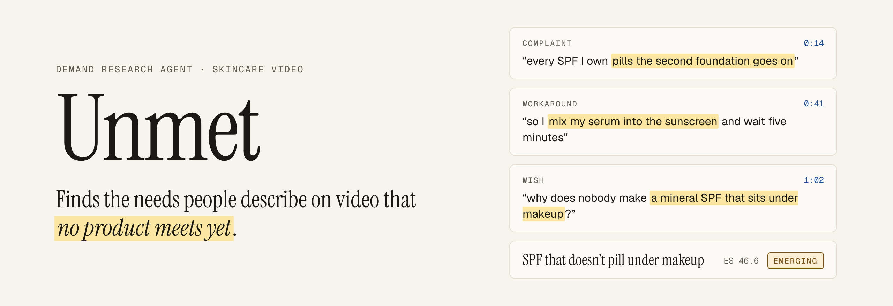
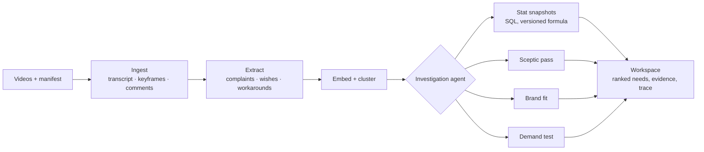

<picture>
  <source media="(prefers-color-scheme: dark)" srcset="docs/assets/banner-dark.png">
  
</picture>

<p>
  <a href="https://github.com/rayhankhilji/Unmet/actions/workflows/ci.yml"></a>
  
  
  
</p>

Unmet is an investigation agent for product teams. It reads short-form skincare video (speech, captions, on-screen frames and comments) and looks for demand that no product meets yet. Then it tries to talk itself out of what it found.

It looks for three kinds of signal:

- **Complaints**: *"this pills under makeup"*
- **Wishes**: *"why does nobody make…"*
- **Workarounds**: people combining two products because no single one does the job. These carry the most weight: someone has already paid, in money and effort, to solve the problem badly.

An investigation groups those signals into needs and sizes each one with deterministic statistics. It then argues against each need, scores how well it fits a specific brand's catalogue, and proposes the cheapest experiment that would confirm or refute it before anyone formulates a product.

> [!NOTE]
> Unmet is in its first build phase. This README describes the system being built; [Status](#status) says what exists today.

## What makes it different from an AI report

**Every claim links to its evidence.** A finding is a set of claims, and each claim points at the transcript line, frame or comment that supports it, with a timestamp and a link to the original post. A claim without evidence is treated as a bug.

**The model never produces a number.** Counts, shares, growth ratios and the Evidence Strength score come from SQL and are stored as immutable snapshots. Any sentence that quotes a number missing from its snapshot is rejected before it reaches the interface.

**It is built to disagree with itself.** A mandatory sceptic pass looks for counterevidence, a single creator doing all the talking, a paid campaign, and one viral video skewing the views. Needs that are concentrated or heavily sponsored are capped at *weak* unless the investigation records an override and cites evidence for it.

**It is scored against what actually happened.** In backtest mode the agent runs blind at a past date. The tool layer refuses any data posted after it. The results are compared with which needs later became launched products, and with a single-prompt baseline given the same corpus.

| The model does | SQL and code do |
|---|---|
| Transcribes speech and describes keyframes | Every count, share, growth ratio and score |
| Extracts signals and points each one at its evidence | Check that cited evidence exists and predates the investigation |
| Labels clusters in plain language | Clustering itself (greedy, cosine ≥ 0.80, order-deterministic) |
| Decides which needs to investigate next | Hide everything posted after `as_of` |
| Writes verdicts, uncertainties and alternatives | Reject any claim whose number isn't in its snapshot |
| Proposes the cheapest test of demand | Cap verdicts for sponsored, concentrated or viral-skewed needs |

## How it works



Evidence Strength ranks needs from 0 to 100. It is weighted towards breadth (many creators), growth over the last two 90-day windows, and spread (no single creator or sponsor dominating). The weights are set by hand and versioned (`es@1`), and the full formula is on the `/about` page. It ranks needs; it does not predict launches.

## Status

Unmet is being built in phases, each with exit criteria that have to pass before the next one starts. The phases are tracked in [`ROADMAP.md`](ROADMAP.md), and progress, decisions and test evidence go in [`TASK_LOG.md`](TASK_LOG.md).

| Phase | | State |
|---|---|---|
| 0 | Foundation: monorepo, schema, design system, CI, fixture corpus | in progress |
| 1 | Corpus: ingestion of real videos | |
| 2 | Signals and stats | |
| 3 | Agent: investigation loop, sceptic, fit, demand tests | |
| 4 | Workspace: the investigation UI | |
| 5 | Proof: extraction, trap, backtest and baseline evals | |
| 6 | Polish and hardening | |
| 7 | Launch | |

The corpus in the repository today is synthetic. [`fixtures/corpus-small`](fixtures/corpus-small) holds 20 invented videos from invented creators, written to exercise every statistic and flag. No real creator content is committed.

## Getting started

You need Node 24, pnpm 10 (`corepack enable`) and Docker.

```bash
pnpm install
```

```bash
pnpm db:up
```

```bash
pnpm db:migrate && pnpm db:seed
```

```bash
pnpm dev
```

The web app runs on http://localhost:3000. No API keys are needed for any of this: environment variables fall back to the committed `.env.example`, and LLM calls in tests are replayed from recorded fixtures.

Postgres listens on port 5433. If that port is taken, start it with `UNMET_DB_PORT=5434 pnpm db:up` and put the same port in `.env.local` and `.env.test`.

### Checks

| Command | What it runs |
|---|---|
| `pnpm lint` | Biome lint and format check |
| `pnpm typecheck` | TypeScript across every package |
| `pnpm test` | Unit, component and integration tests (Vitest; integration tests use per-worker Postgres databases) |
| `pnpm test:coverage` | The same, with coverage thresholds |
| `pnpm test:e2e` | Playwright against a production build and a seeded database, with axe accessibility checks |
| `pnpm design:contrast` | WCAG contrast for every token pair, light and dark |
| `pnpm check:policy` | Every mutating route calls an access-policy helper |

CI runs all of them, plus a secret scan, a dependency audit and a migrate-and-seed from an empty database.

## Repository layout

```
apps/
  web/       Next.js 16 UI and /api/v1
  worker/    Investigation and eval runner (Postgres-backed queue)
  cli/       Database reset and seed now; ingest, extract and eval later
  mcp/       Read-only MCP server for coding agents
packages/
  db/        Drizzle schema, migrations, repositories, test databases
  stats/     Deterministic statistics and Evidence Strength
  llm/       Model clients, pricing, record and replay for tests
  shared/    Zod contracts, enums, error codes, env loading
fixtures/    Synthetic corpus and recorded LLM responses
data/        Brand catalogues (fictional) and, locally, raw media
prompts/     Versioned prompt files (from Phase 2)
evals/       Gold labels, trap and backtest cases
```

The stack is Next 16, React 19, Tailwind 4, Drizzle on Postgres 16 with pgvector, Zod 4, Vitest, Playwright and Biome. Exact versions and the reasons for each choice are in [`ARCHITECTURE.md`](ARCHITECTURE.md) §2.

## Working on it with a coding agent

The repository is set up to be worked on by coding agents as well as people. [`INSTRUCTIONS.md`](INSTRUCTIONS.md) is the shared entry point. Claude Code, Cursor, VS Code/Copilot, Codex and Gemini CLI each have their own pointer to it and an MCP configuration listing the same servers.

The project ships its own MCP server, [`apps/mcp`](apps/mcp). It gives an agent read-only SQL access to the local database, plus table descriptions, investigation lists and run traces. It runs every query in a read-only transaction and refuses non-local databases by default. Setup for each tool, along with the hosted connectors (Neon, Vercel, Sentry, PostHog, Cloudflare, Upstash, GitHub), is described in [`docs/agents.md`](docs/agents.md).

## Documents

| Document | What it covers |
|---|---|
| [`PRD.md`](PRD.md) | Users, journeys, features and acceptance criteria, success metrics |
| [`ARCHITECTURE.md`](ARCHITECTURE.md) | System design, data model, API, AI subsystem, security, decisions |
| [`DESIGN_SYSTEM.md`](DESIGN_SYSTEM.md) | Tokens, type, components, screens, voice, accessibility |
| [`TESTING_GUIDE.md`](TESTING_GUIDE.md) | Test pyramid, databases, fixtures, eval methodology |
| [`EVAL_GUARDRAILS.md`](EVAL_GUARDRAILS.md) | Rules a change must not break, and how each is checked |
| [`ROADMAP.md`](ROADMAP.md) | Phases, tasks and exit criteria |

## Data and creators

Videos are collected by hand from public posts using fixed search queries and date buckets. These are decided before any collection and recorded against each video. Nothing is scraped. Media and keyframes are stored privately and never served. Evidence appears as a short excerpt with a link to the original post. Creators who appear to be under 18 are excluded, and comment authors are stored only as salted hashes.

If you are a creator and want your videos removed, [open an issue](https://github.com/rayhankhilji/Unmet/issues). Removal deletes the videos and everything derived from them.

## Context

Unmet is an independent prototype built by [Rayhan Khilji](https://github.com/rayhankhilji) as part of an application to [Plot](https://plot.so). Plot already indexes what creators say, show and use across short-form video. Unmet asks what that understanding is worth to the people deciding which products to make. It is not affiliated with or endorsed by Plot.
