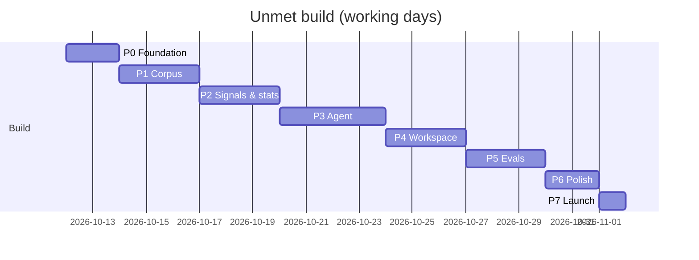

# Unmet — Roadmap

> Version: 1.0 · Updated: 2026-10-09 · Vertical slices: every phase ends deployable to a Vercel preview with testable exit criteria. Tasks marked **(human)** are done by Rayhan, not the coding agent.

## Overview

| Phase | Goal | Features | Est. effort |
|---|---|---|---|
| P0 | Foundation: repo, CI, DB, tokens, app shell, fixtures, deploy | F-13 (skeleton), F-14 (shell) | 2 days |
| P1 | Real corpus ingested and visible on `/about` | F-01, F-14 | 3 days |
| P2 | Signals extracted, needs sized deterministically, extraction eval | F-02, F-03, F-09 (extraction) | 3 days |
| P3 | Agent investigates end to end from the CLI and worker | F-04, F-05, F-06, F-07, F-10 (data) | 4 days |
| P4 | The workspace: watch, interrogate, open evidence; gated live runs | F-08, F-10, F-13 | 3 days |
| P5 | Proof: traps, backtest, baseline comparison, eval dashboard | F-09 | 3 days |
| P6 | Polish & hardening | all | 2 days |
| P7 | Launch & application | — | 1 day |

## Phase 0 — Foundation

**Goal:** a deployed app shell on a real database with tokens, fixtures and CI, so every later slice lands on solid ground.

**Tasks:**
- [ ] P0.T1 — Verify current stable versions (Node, Next.js, Tailwind, Drizzle, Zod, SDKs) and model IDs/prices; record them in TASK_LOG Decisions and `packages/llm/src/pricing.ts` · refs: ARCHITECTURE §2, §10.1, EVAL_GUARDRAILS §4, G-PRIV-04 · verify: table recorded; `pnpm typecheck` on pricing file
- [ ] P0.T2 — Scaffold pnpm + Turborepo monorepo with all apps/packages from INSTRUCTIONS §4, strict tsconfig, Biome, `.env.example`, `.env.test.example` · verify: `pnpm install && pnpm typecheck && pnpm lint`
- [ ] P0.T3 — Docker compose (pgvector pg16 on 5433), Drizzle config, migration 0000 (vector extension, all enums) and 0001 (all tables + indexes from ARCHITECTURE §4) · refs: ARCHITECTURE §4 · verify: `pnpm db:up && pnpm db:migrate`; integration test lists every table
- [ ] P0.T4 — Env validation for web, worker and cli (Zod / t3-env); boot fails fast with a named missing var · refs: ARCHITECTURE §12, G-SEC-09 · verify: unit test on env schemas
- [ ] P0.T5 — `packages/shared`: enums, error codes, `AppError`, API schemas from ARCHITECTURE §5.3; `withErrorEnvelope` helper · refs: ARCHITECTURE §5.4, EVAL_GUARDRAILS §5 · verify: schema unit tests
- [ ] P0.T6 — Test harness: Vitest projects, `withTestTx`, factories, MSW with `LLM_MODE=replay`, Playwright + axe helper · refs: TESTING_GUIDE §2, §4 · verify: sample tests pass in CI
- [ ] P0.T7 — Design tokens, fonts, Tailwind `@theme`, dark mode, AppShell (top bar, nav, toasts), base shadcn components; `pnpm design:contrast` script · refs: DESIGN_SYSTEM §2–§6, §8 · verify: visual snapshot of shell light/dark; contrast script passes
- [ ] P0.T8 — Fixture corpus `fixtures/corpus-small/` (20 synthetic videos with transcripts, frames descriptions, comments, signals) and `pnpm db:seed` scenarios from TESTING_GUIDE §4.2, including demo investigations · verify: `pnpm db:reset && pnpm db:seed`; row-count test
- [ ] P0.T9 — `GET /api/v1/health`, `policy.ts` skeleton (`canRead`, `requireAdmin`, `requirePasscode`), admin session routes, request ID middleware, security headers · refs: F-13, ARCHITECTURE §11, G-SEC-01..08 · verify: T-F13-AC1 (route exists, 401 path), `e2e/headers.spec.ts`
- [ ] P0.T10 — CI workflow (TESTING_GUIDE §9 steps 1–6), Vercel project (web) + Neon preview branches; Sentry + PostHog wiring (no-op when unset) · verify: green CI on a PR; preview URL serves the shell
- [ ] P0.T11 — `/about` static shell with the methodology sections and a stats block reading `GET /api/v1/corpus/stats` from seeded data · refs: F-14 · verify: T-F14-AC1, T-F14-AC2
- [ ] P0.T12 **(human)** — Decide corpus sourcing approach (PRD Q1); define 6–10 fixed collection queries and date buckets; write them into `data/collection-plan.md` · verify: file committed before any collection
- [ ] P0.T13 **(human)** — Interview 3–5 people who make product or creator decisions at beauty brands; record findings in `docs/research/interviews.md` · verify: file committed; findings referenced in TASK_LOG Decisions

**Exit criteria:**
- `pnpm install && pnpm db:up && pnpm db:migrate && pnpm db:seed && pnpm test && pnpm build` passes from a clean clone.
- The Vercel preview shows the AppShell and `/about` with seeded stats in light and dark modes with zero axe violations.
- Every table and enum from ARCHITECTURE §4 exists in the migrated database.

**Out of this phase:** real videos, LLM calls, agent code.

## Phase 1 — Corpus (F-01, F-14)

**Goal:** 300–500 real skincare videos ingested with transcripts, keyframes, descriptions and comments, and visible as live stats on `/about`.

**Tasks:**
- [ ] P1.T1 **(human)** — Assemble `data/manifest.csv` and `data/raw/` per the collection plan; tag likely minors/exclusions; add `collection_query` and `provenance_note` per row · refs: PRD A1, G-PRIV-01 · verify: `pnpm manifest:check` passes
- [ ] P1.T2 — `pnpm manifest:check` + manifest loader: validate rows (Zod), upsert creators (tier derived) and videos, honour `exclude`/`likely_minor` · refs: F-01 · verify: T-F01-AC4
- [ ] P1.T3 — `packages/storage` with `fs` and `r2` drivers; media upload stage · verify: unit tests for both drivers (r2 via MSW)
- [ ] P1.T4 — Transcription stage: ffmpeg audio extraction, `whisper-1` verbose JSON, segments insert, stage-skipping idempotency · refs: F-01, ARCHITECTURE §6.1 · verify: T-F01-AC1 (transcript part), T-F01-AC2
- [ ] P1.T5 — Keyframe stage: first frame at 0.5 s + scene detection (threshold 0.35), 4–8 frames, 512 px JPEG · verify: `@ffmpeg` test on `sample-12s.mp4` yields 4–8 frames
- [ ] P1.T6 — Vision stage: `prompts/vision.keyframes.v1.md`, batch description via `callStructured`, products_visible and on_screen_text · refs: G-AI-01, G-AI-08 · verify: replay test; T-F01-AC1
- [ ] P1.T7 — Comments stage: load `<id>.comments.json`, hash authors with `COMMENT_HASH_SALT`, keep top 50 by likes · verify: T-F01-AC5
- [ ] P1.T8 — `packages/llm` core: `callModel`, `callStructured` (repair-retry ×2), retries/backoff, fallback, token + cost accounting, prompt registry loader · refs: ARCHITECTURE §10.2, §10.8, G-AI-15 · verify: unit tests with mocked 429/529 and cost math
- [ ] P1.T9 — `pnpm ingest` orchestration: concurrency 4, per-video status, failure codes, running cost printout, sweep cap (G-COST-02) · verify: T-F01-AC1, T-F01-AC3
- [ ] P1.T10 — Run ingest on the real corpus; fix failures until ≥ 95 % of rows are `complete` · verify: SQL count recorded in TASK_LOG
- [ ] P1.T11 — `/about` live corpus block: videos, creators, date range, platform mix, follower-tier mix, exclusions count · refs: F-14 · verify: T-F14-AC1 against real data on preview

**Exit criteria:**
- ≥ 300 videos `complete`; none from `likely_minor` creators; no raw comment handles in the database.
- Re-running `pnpm ingest` makes zero external calls for completed videos.
- `/about` on the preview shows counts equal to SQL.

**Out of this phase:** signal extraction, embeddings.

## Phase 2 — Signals & stats (F-02, F-03, F-09 extraction)

**Goal:** every video yields validated demand signals with evidence, and needs can be clustered and sized deterministically at any `as_of`.

**Tasks:**
- [ ] P2.T1 — `prompts/extract.signals.v1.md` + extraction schema; untrusted-content wrapping; evidence-ref validation; workaround rule; deterministic sponsored rule · refs: F-02, G-AI-01 · verify: T-F02-AC1, T-F02-AC2, T-F02-AC4
- [ ] P2.T2 — `pnpm extract` with repair retries, `extract_status`, sweep cap · verify: T-F02-AC3; run on real corpus, ≥ 95 % complete
- [ ] P2.T3 — `pnpm embed`: batch need-statement embeddings (100/batch) + catalogue product embeddings; HNSW index check · verify: integration test; all signals have embeddings
- [ ] P2.T4 — `packages/db/src/repos/asof.ts` and as-of scoped signal/video repositories; lint restriction for agent tools · refs: ARCHITECTURE §10.4, G-AI-04 · verify: T-F09-AC2 (repository level), T-F03-AC2
- [ ] P2.T5 — `packages/stats`: greedy centroid clustering (cos ≥ 0.80, min 3, sarcastic excluded), need labelling prompt `need.label.v1` · refs: F-03, ARCHITECTURE §10.6 · verify: clustering unit tests with `nearTo` vectors
- [ ] P2.T6 — Stat snapshot computation, flags and Evidence Strength `es@1` · verify: T-F03-AC1, T-F03-AC3, T-F03-AC4
- [ ] P2.T7 **(human)** — Hand-label 60 real videos into `evals/gold/extraction.jsonl` (signal types, workaround yes/no, sponsored, sarcasm) **before** looking at model outputs for them · verify: file committed with labelling guide `evals/gold/README.md`
- [ ] P2.T8 — Extraction eval suite + scorer, eval_run persistence, staleness via prompt versions · refs: F-09 · verify: T-F09-AC1, T-F09-AC5; real run recorded
- [ ] P2.T9 — Iterate extraction prompt to thresholds G-EVAL-01..03 (new prompt version per change); record each run's metrics in TASK_LOG · verify: `pnpm eval:extraction` meets thresholds or miss documented
- [ ] P2.T10 — `/about` adds signals-by-type and the Evidence Strength formula block · refs: F-14 · verify: E2E about spec

**Exit criteria:**
- `pnpm eval:extraction` recorded with macro-F1, workaround precision and sponsored recall on the gold set.
- Snapshots for a fixed `as_of` are byte-identical across two runs.
- No repository used by agent code can return a row after `as_of` (T-F09-AC2 green).

**Out of this phase:** the agent loop, UI for needs.

## Phase 3 — Agent (F-04, F-05, F-06, F-07, F-10 data)

**Goal:** `pnpm run:investigation` and the worker produce validated, capped, cited findings with fit and demand tests, every step persisted.

**Tasks:**
- [ ] P3.T1 — Brand files: the demo brand `lrp-like.json` and the fictional test brand `fixture-skin.json` (`data/brands/`) and `pnpm brands:load` with validation · refs: F-06 · verify: T-F06-AC2
- [ ] P3.T2 — Read tools: `list_needs`, `get_need_stats`, `search_signals` (hybrid RRF), `inspect_video` with output truncation · refs: ARCHITECTURE §10.3 · verify: tool integration tests incl. T-F09-AC2 at tool level
- [ ] P3.T3 — `find_counterevidence` (already-solved search, contradicting stance, sarcasm, concentration, sponsorship, trend) with sceptic marker event · refs: F-05 · verify: integration tests on trap fixtures 1–3, 6
- [ ] P3.T4 — `record_finding` with full validation path (ARCHITECTURE §6.3), numbers-in-snapshot validator, caps · refs: F-04, F-05, G-AI-05..07 · verify: T-F04-AC2, T-F04-AC3, T-F04-AC4, T-F05-AC1, T-F05-AC2
- [ ] P3.T5 — `assess_brand_fit` with `fit.score.v1`, deterministic coverage match · refs: F-06 · verify: T-F06-AC1
- [ ] P3.T6 — `propose_demand_test` + deny-list validator + `finish` · refs: F-07, G-AI-14 · verify: T-F07-AC2, T-F07-AC3
- [ ] P3.T7 — Agent loop: system prompt `agent.system.v1`, tool dispatch, context compaction, limits, fallback, run_event persistence, cost accounting · refs: ARCHITECTURE §10.5, G-AI-09 · verify: T-F04-AC5, T-F04-AC6, loop unit tests
- [ ] P3.T8 — `pnpm run:investigation` CLI and first real runs; record fixtures for the happy-path replay test · verify: T-F04-AC1, T-F07-AC1 (replay)
- [ ] P3.T9 — Worker: queue claim (`SKIP LOCKED`), concurrency 2, heartbeat, reaper, timeouts, circuit breaker, Dockerfile with ffmpeg, Railway deploy · refs: ARCHITECTURE §9 · verify: worker integration tests (claim, reap); a run queued on preview DB completes on Railway
- [ ] P3.T10 — Prompt-injection trap fixture and no-leak scanner · refs: G-AI-01, G-AI-10 · verify: T-AI-INJECT, T-AI-NOLEAK
- [ ] P3.T11 — Read API for runs: `GET investigations`, `/:id`, `/:id/findings`, `/:id/events`, `evidence/:id`, `stat-snapshots/:id` with policy · refs: ARCHITECTURE §5.2, F-10 · verify: T-F10-AC1 (API), T-F10-AC2, T-F13-AC4

**Exit criteria:**
- Three real investigations at different `as_of` dates complete in ≤ 6 min and ≤ $3.00 each, each with 3–5 findings, every claim cited, zero unsupported numbers.
- A queued run on the preview database is completed by the Railway worker.
- All P3 test IDs green.

**Out of this phase:** baseline, backtests, workspace UI beyond raw API.

## Phase 4 — Workspace (F-08, F-10, F-13)

**Goal:** a cold visitor can open a published investigation, interrogate any need, and open the exact evidence; passcode holders can watch a live run.

**Tasks:**
- [ ] P4.T1 — Home page: hero, published investigation cards, eval strip placeholder reading eval-runs (renders "Evals coming soon" state when none) · refs: DESIGN_SYSTEM §9.1, F-08 · verify: E2E home spec, all states
- [ ] P4.T2 — Workspace layout + NeedCard + VerdictStamp (incl. cap moment) + server-rendered findings · refs: DESIGN_SYSTEM §9.3 · verify: T-F08-AC1, T-F06-AC3
- [ ] P4.T3 — Need detail tabs (Evidence, Sceptic, Brand fit, Demand test) with ClaimRow and StatValue (snapshot popover) · verify: component tests; E2E tab navigation
- [ ] P4.T4 — Evidence drawer/sheet with URL state, highlight wipe, open-original links, evidence_unavailable state · verify: T-F08-AC3, T-F08-AC4, T-F08-AC6
- [ ] P4.T5 — Live timeline with polling hook, terminal-state handling, failed and budget_exceeded banners · verify: T-F08-AC2, T-F08-AC5
- [ ] P4.T6 — New investigation page + `POST /api/v1/investigations` with passcode, idempotency, per-IP limit, concurrency, daily budget · refs: F-13 · verify: T-F13-AC1, T-F13-AC2, T-F13-AC3
- [ ] P4.T7 — Trace page `/traces/[id]` · refs: F-10, DESIGN_SYSTEM §9.5 · verify: T-F10-AC1 (E2E)
- [ ] P4.T8 — Admin page: login, run list, publish/unpublish, cancel · refs: F-13 · verify: T-F13-AC5
- [ ] P4.T9 — Keyboard shortcuts + `?` dialog, aria-live timeline, PostHog events · refs: DESIGN_SYSTEM §9.3, §11 · verify: E2E keyboard spec; axe clean

**Exit criteria:**
- On the preview: J1 (cold reviewer reaches evidence in ≤ 3 clicks) and J2 (live run end to end) pass as Playwright specs.
- Workspace LCP < 2.0 s on preview; zero serious/critical axe violations on all P4 pages.
- Publishing a run from `/admin` makes it appear on the home page.

**Out of this phase:** eval dashboard, ledger.

## Phase 5 — Proof (F-09)

**Goal:** honest, reproducible evidence that Unmet works and beats a single-prompt baseline.

**Tasks:**
- [ ] P5.T1 — Six trap corpora + `pnpm db:seed:traps`; traps suite runner and scorer (judge only for trap 5 summary check) · refs: TESTING_GUIDE §4.4 · verify: T-F05-AC3 recorded
- [ ] P5.T2 **(human)** — Select and commit backtest cases per TESTING_GUIDE §4.5 before running any system on them · verify: `evals/backtest/cases.json` committed with timestamp
- [ ] P5.T3 — Backtest runner: eval-origin investigations at each `as_of`, judge `judge.backtest_match.v1`, hit@5 and FP rate, split by `leakage_class` · refs: G-AI-10, G-AI-11 · verify: runner integration test with replay; real run recorded
- [ ] P5.T4 — Baseline system (`agent.baseline.v1`, 150k truncation, parse into finding tables) · refs: ARCHITECTURE §10.7 · verify: replay test parses fixture output
- [ ] P5.T5 — Comparison suite: citation precision judge (`judge.citation_support.v1`), unsupported-number counter, trap pass rate for both systems · verify: scorer unit tests; real run recorded
- [ ] P5.T6 **(human)** — Spot-check 30 judge decisions; record agreement in `evals/human/judge-check.json` · refs: G-EVAL-10 · verify: file committed
- [ ] P5.T7 — `/evals` and `/evals/[id]` pages with stale badges, leakage split, failure-first case list, links to traces · refs: F-09, DESIGN_SYSTEM §9.4 · verify: T-F09-AC3, T-F09-AC4
- [ ] P5.T8 — Failure analysis: write the top failure modes and fixes tried into `/about` Limitations and TASK_LOG · verify: E2E about spec checks the section renders

**Exit criteria:**
- `pnpm eval:all` has run on frozen prompt versions; all four suites visible on `/evals` with Unmet vs baseline.
- Each threshold in EVAL_GUARDRAILS §7.3 is met, or the miss is displayed with its failure analysis.
- No gold strings found in any prompt sent during backtests (T-AI-NOLEAK green).

**Out of this phase:** prediction ledger UI, handoff export.

## Phase 6 — Polish & Hardening

**Goal:** it looks and feels finished, and nothing embarrassing happens on a public link.

**Tasks:**
- [ ] P6.T1 — Motion pass across all patterns in DESIGN_SYSTEM §6, including reduced-motion variants · verify: manual QA §10; visual snapshots updated intentionally
- [ ] P6.T2 — Empty/error/edge state review on every screen against DESIGN_SYSTEM §9 · verify: `e2e/workspace-states.spec.ts` covers all states
- [ ] P6.T3 — Accessibility audit (keyboard-only walkthrough of J1–J4, screen reader spot check with VoiceOver) · verify: zero axe violations; notes in TASK_LOG
- [ ] P6.T4 — Performance pass: bundle ≤ 220 KB, Lighthouse ≥ 90, k6 smoke on read APIs · refs: G-PERF-01..06 · verify: CI outputs
- [ ] P6.T5 — Security checklist G-SEC-01..13 walkthrough on production config; gitleaks + audit clean · verify: checklist ticked in TASK_LOG
- [ ] P6.T6 — Copy review: British spelling, voice rules, limitations honesty · verify: manual QA §10
- [ ] P6.T7 — UX rubric scoring of J1–J3 by Rayhan + one outside person; fix anything < 4 · refs: EVAL_GUARDRAILS §7.2 · verify: scores recorded

**Exit criteria:**
- Full verification loop green; every UX rubric score ≥ 4; security checklist complete.

## Phase 7 — Launch

**Goal:** production is live and the application is sent.

**Tasks:**
- [ ] P7.T1 — Production env vars, custom domain, `PUBLIC_DEMO_MODE=true`, `LIVE_RUNS_ENABLED=true`, budgets set; Neon snapshot branch · verify: production health check; T-F13-AC4 against production
- [ ] P7.T2 — Run 2–3 final investigations on production; publish the best one or two **(human approval)** · verify: home page shows them
- [ ] P7.T3 — Rollback rehearsal (promote previous Vercel deploy, redeploy previous worker image) · verify: noted in TASK_LOG
- [ ] P7.T4 **(human)** — Record the 2-minute demo video and write the one-page write-up (problem, method, eval results incl. failures, how it plugs into Plot's index, what's next) · verify: files linked in TASK_LOG
- [ ] P7.T5 **(human)** — Send the application email to Plot's founder with the live link, video, write-up and links to shipped products · verify: sent date in TASK_LOG

**Exit criteria:**
- Production serves the published investigation, evals and about page; a live run with the passcode completes; the application is sent.

## Later / Backlog

- F-11 Prediction ledger (`/ledger`, outcome recording, calibration chart).
- F-12 Creator handoff export.
- Corpus browser page (`/corpus`) listing videos, provenance and signals.
- Blind human preference test with 3–5 marketers (PRD Q3), results on `/evals`.
- Second category (e.g. haircare) to test generality.

## Feature → Phase Map

| Feature | Priority | Phase | Tasks |
|---|---|---|---|
| F-01 Corpus ingestion | P0 | P1 | P1.T1–P1.T10 |
| F-02 Signal extraction | P0 | P2 | P2.T1–P2.T3, P2.T9 |
| F-03 Clustering & sizing | P0 | P2 | P2.T4–P2.T6 |
| F-04 Investigation agent | P0 | P3 | P3.T2, P3.T4, P3.T7–P3.T9 |
| F-05 Sceptic pass | P0 | P3, P5 | P3.T3, P3.T4, P5.T1 |
| F-06 Brand fit | P0 | P3, P4 | P3.T1, P3.T5, P4.T2 |
| F-07 Demand test | P0 | P3 | P3.T6, P3.T8 |
| F-08 Workspace UI | P0 | P4 | P4.T1–P4.T5, P4.T9 |
| F-09 Evaluation harness | P0 | P2, P5 | P2.T7–P2.T9, P5.T1–P5.T8 |
| F-10 Traces | P0 | P3, P4 | P3.T11, P4.T7 |
| F-11 Prediction ledger | P1 | Backlog | — |
| F-12 Creator handoff | P1 | Backlog | — |
| F-13 Demo mode & gating | P0 | P0, P4, P7 | P0.T9, P4.T6, P4.T8, P7.T1 |
| F-14 Methodology page | P0 | P0–P2, P5 | P0.T11, P1.T11, P2.T10, P5.T8 |
